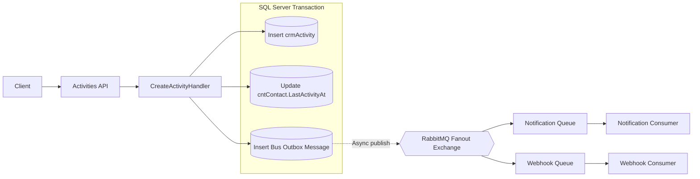

# Architecture Decisions

## Responsibility boundaries

The legacy API performed all of the following work synchronously:

- inserted an Activity;
- updated `LastActivityAt` on an existing Contact;
- created an internal Notification; and
- called an external Webhook.

This design made API latency and availability depend on the Webhook destination. The redesigned CRM remains responsible for the Activity, `Contact.LastActivityAt`, request idempotency, and reliable event publication because these concerns belong to the same business transaction.

Notification creation and Webhook delivery are now asynchronous. Their Consumers remain in the same monolith for this assignment because separate deployments would add unnecessary operational complexity. In a larger system, these boundaries could become independent Notification and Integration services because they have different workloads and failure modes.

## Activity creation flow

The API remains synchronous only up to SQL Server. A unique index on `(TenantId, RequestKey)` enforces idempotency. Repeating a request with the same payload returns the existing result; reusing the key with a different payload returns a conflict.

`LastActivityAt` only advances when the new Activity has a later timestamp. An EF Core concurrency token and a bounded retry protect this monotonic rule when requests commit concurrently.

One `SaveChanges` call inserts the Activity, updates `Contact.LastActivityAt`, and inserts the Bus Outbox message. All three changes commit or roll back together. The exchange uses fanout because every `ActivityCreatedEvent` must reach both durable queues without routing-key filtering.

## Asynchronous communication and failures

MassTransit delivers persisted Outbox messages to RabbitMQ. During a broker outage, new Activity requests can still commit to SQL Server and their messages remain in the Outbox until connectivity is restored. Receive endpoints cannot consume new messages while the broker is unavailable, but the Activity transaction is not lost.

RabbitMQ provides at-least-once delivery, so duplicate delivery is expected. The Notification Consumer uses the MassTransit EF Inbox and a unique index on `ActivityId`. The Webhook Consumer creates a unique `WebhookDelivery` before making the HTTP call.

Successful Webhook calls mark the delivery as `Succeeded`. Failed attempts persist the error, attempt time, and attempt count. Retries run after 1, 5, and 15 seconds. After the final failure, the delivery is marked as `Failed` and the message moves to the MassTransit error queue.

There is an unavoidable failure window between a successful HTTP response and persisting `Succeeded`. The Webhook destination must therefore treat `ActivityId`, sent as the idempotency key, as unique.

## Deployment, Migration, and Backfill

The transition follows an Expand/Contract approach:

1. **Expand:** Add the new tables, nullable `RequestKey`, filtered unique indexes, and MassTransit Outbox/Inbox tables. The legacy version remains compatible.
2. **Deploy:** Deploy the new version to create its durable queues, then enable Outbox delivery. Legacy and new writers may run together during the transition.
3. **Backfill:** Batch scripts translate legacy flags into Notification and Webhook records. A polling worker selects only legacy Activities where `RequestKey IS NULL`. It writes the event, release ledger, and Outbox data in one transaction, so late writes from the legacy version are not missed.
4. **Verify:** Run the reconciliation script until legacy-flag differences, unreleased records, and pending side effects are understood and resolved.
5. **Contract:** After the legacy writer has stopped and reconciliation is clean, remove the legacy flags in a separate migration. This step is intentionally excluded to preserve rollback capability.

## Recovery and migration verification

Operational verification should include the remaining Outbox messages, RabbitMQ queue and error-queue depths, `Pending` and `Failed` Webhook deliveries, `AttemptCount`, and the reconciliation query results.

Recovery consists of restoring broker connectivity, fixing the Webhook destination and redriving failed messages, or rerunning the Backfill. Unique indexes, the EF Inbox, and the release ledger make these operations safe to repeat.

Integration tests use real SQL Server and RabbitMQ instances through Testcontainers. They cover transaction atomicity, concurrent requests with the same key, duplicate delivery, broker recovery, and repeatable Backfill execution.

Health endpoints, a metrics dashboard, and distributed tracing are intentionally excluded. They are valuable production concerns but are not direct requirements of this interview assignment.
